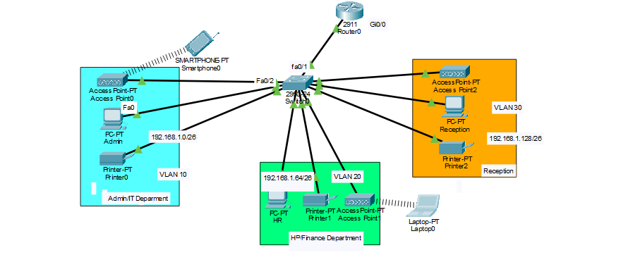
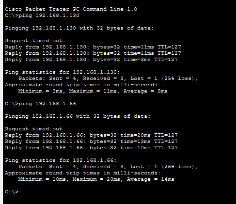

# XYZ Company Branch Network (Cisco Packet Tracer)

A small branch-office network for XYZ Company's new branch near Bonalbo, designed and implemented in Cisco Packet Tracer. The branch network operates separately from the HQ network.

## Requirements

- One router and one switch (all Cisco products)
- 3 departments: Admin/IT, Finance/HR, and Customer Service/Reception
- Each department in a different VLAN
- Each department has a wireless network for its users
- Hosts obtain IPv4 addresses automatically (DHCP)
- Devices in all departments can communicate with each other
- Base network provided by the ISP: `192.168.1.0`

## Topology



| Device | Model | Quantity |
|--------|-------|----------|
| Router | Cisco 2911 | 1 |
| Switch | Cisco 2960-24TT | 1 |
| Access Points | Access-Point-PT | 3 (one per department) |
| PCs | PC-PT | 3 (Admin, HR, Reception) |
| Printers | Printer-PT | 3 |
| Wireless clients | Smartphone-PT, Laptop-PT | 1 each (for wireless testing) |

## Addressing Plan

The base network `192.168.1.0` is subnetted with mask **255.255.255.192 (/26)**, giving 4 subnets of 62 usable hosts each. The first three are used, and the fourth is spare for future growth.

| Department | VLAN ID | Network | Mask | Usable Range | Gateway (Router) | Broadcast |
|------------|---------|---------|------|--------------|------------------|-----------|
| Admin/IT | 10 | 192.168.1.0/26 | 255.255.255.192 | 192.168.1.1 - .62 | 192.168.1.1 | 192.168.1.63 |
| Finance/HR | 20 | 192.168.1.64/26 | 255.255.255.192 | 192.168.1.65 - .126 | 192.168.1.65 | 192.168.1.127 |
| Reception | 30 | 192.168.1.128/26 | 255.255.255.192 | 192.168.1.129 - .190 | 192.168.1.129 | 192.168.1.191 |
| *(spare)* | - | 192.168.1.192/26 | 255.255.255.192 | 192.168.1.193 - .254 | - | 192.168.1.255 |

## Design Overview

- **VLANs** separate each department into its own broadcast domain on the single switch.
- **Router-on-a-stick** provides inter-VLAN routing. The router's `Gi0/0` connects to the switch's `Fa0/1`, which is a trunk port. The router uses one subinterface per VLAN, and each subinterface is that VLAN's default gateway.
- **DHCP** is configured on the router, with one pool per VLAN, so PCs, printers, and wireless devices get addresses automatically.
- **Wireless**: each department has an access point connected to a switch port in that department's VLAN. Wireless clients join the AP and receive an address from that VLAN's DHCP pool.

## Configuration

> Port numbers below are examples. Adjust them to match the ports used in your `.pkt` file.

### Switch

```
Switch> enable
Switch# configure terminal
Switch(config)# hostname SW1

! Create VLANs
SW1(config)# vlan 10
SW1(config-vlan)# name ADMIN-IT
SW1(config-vlan)# vlan 20
SW1(config-vlan)# name FINANCE-HR
SW1(config-vlan)# vlan 30
SW1(config-vlan)# name RECEPTION
SW1(config-vlan)# exit

! Admin/IT ports (PC, printer, access point)
SW1(config)# interface range fa0/2 - 4
SW1(config-if-range)# switchport mode access
SW1(config-if-range)# switchport access vlan 10
SW1(config-if-range)# exit

! Finance/HR ports
SW1(config)# interface range fa0/5 - 7
SW1(config-if-range)# switchport mode access
SW1(config-if-range)# switchport access vlan 20
SW1(config-if-range)# exit

! Reception ports
SW1(config)# interface range fa0/8 - 10
SW1(config-if-range)# switchport mode access
SW1(config-if-range)# switchport access vlan 30
SW1(config-if-range)# exit

! Trunk to router
SW1(config)# interface fa0/1
SW1(config-if)# switchport mode trunk
SW1(config-if)# end
SW1# wr
```

### Router

```
Router> enable
Router# configure terminal
Router(config)# hostname R1

! Physical interface (no IP address here)
R1(config)# interface gi0/0
R1(config-if)# no shutdown
R1(config-if)# exit

! Subinterfaces (gateways)
R1(config)# interface gi0/0.10
R1(config-subif)# encapsulation dot1Q 10
R1(config-subif)# ip address 192.168.1.1 255.255.255.192
R1(config-subif)# exit

R1(config)# interface gi0/0.20
R1(config-subif)# encapsulation dot1Q 20
R1(config-subif)# ip address 192.168.1.65 255.255.255.192
R1(config-subif)# exit

R1(config)# interface gi0/0.30
R1(config-subif)# encapsulation dot1Q 30
R1(config-subif)# ip address 192.168.1.129 255.255.255.192
R1(config-subif)# exit

! DHCP: keep the gateway addresses out of the pools
R1(config)# ip dhcp excluded-address 192.168.1.1
R1(config)# ip dhcp excluded-address 192.168.1.65
R1(config)# ip dhcp excluded-address 192.168.1.129

R1(config)# ip dhcp pool ADMIN-IT
R1(dhcp-config)# network 192.168.1.0 255.255.255.192
R1(dhcp-config)# default-router 192.168.1.1
R1(dhcp-config)# exit

R1(config)# ip dhcp pool FINANCE-HR
R1(dhcp-config)# network 192.168.1.64 255.255.255.192
R1(dhcp-config)# default-router 192.168.1.65
R1(dhcp-config)# exit

R1(config)# ip dhcp pool RECEPTION
R1(dhcp-config)# network 192.168.1.128 255.255.255.192
R1(dhcp-config)# default-router 192.168.1.129
R1(dhcp-config)# end
R1# wr
```

### Wireless

On each access point (Config tab → Port 1 → SSID), set an SSID per department, for example `ADMIN-IT`, `FINANCE-HR`, and `RECEPTION`, and configure the security settings. On the wireless client (smartphone or laptop), set the IP configuration to **DHCP** and connect to the matching SSID.

## Verification

Useful commands:

```
SW1# show vlan brief
SW1# show interfaces trunk
R1# show ip interface brief
R1# show ip dhcp binding
R1# show running-config
```

Connectivity tests (all should succeed):

- Admin PC → HR PC
- Admin PC → Reception PC
- HR PC → Reception PC
- Wireless laptop/smartphone → PCs in other departments



## Repository Structure

```
.
├── README.md
├── network_designing_using_vlan.pkt
├── images/
│   ├── topology.png
│   └── ping-test.png
└── configs/
    ├── router-config.txt
    └── switch-config.txt
```

## How to Open

Open `network_designing_using_vlan.pkt` with Cisco Packet Tracer.
